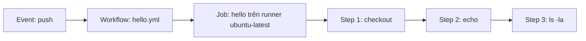

# Workflow đầu tiên

Bạn đã biết đẩy code lên GitHub. **GitHub Actions** cho GitHub tự làm việc thay bạn mỗi khi có chuyện xảy ra trong repo: có người push, mở pull request, hay tới giờ hẹn. Việc đó có thể là chạy test, kiểm tra link hỏng, build rồi deploy trang web.

Cả track này dùng **portfolio HTML/CSS của bạn** làm dự án xuyên suốt. Cuối track, mỗi lần bạn push, GitHub sẽ tự kiểm tra, đóng gói và đưa portfolio lên mạng.

## Các khái niệm

| Khái niệm | Là gì | Ví dụ |
| --- | --- | --- |
| **Workflow** | Một quy trình tự động, viết trong file YAML ở `.github/workflows/` | `hello.yml` |
| **Event** | Sự kiện kích hoạt workflow, khai báo ở `on:` | `push`, `pull_request` |
| **Job** | Một nhóm bước chạy trên **cùng một máy** | `hello`, `deploy` |
| **Step** | Một bước trong job: chạy lệnh (`run`) hoặc dùng action có sẵn (`uses`) | `run: ls -la` |
| **Runner** | Máy ảo GitHub cấp để chạy job, chạy xong là xóa | `ubuntu-latest` |
| **Action** | Một bước đóng gói sẵn để dùng lại | `actions/checkout@v7` |



## Viết workflow

Trong repo portfolio, tạo file `.github/workflows/hello.yml`:

```yaml
name: Hello

on: push

jobs:
  hello:
    runs-on: ubuntu-latest
    steps:
      - name: Lấy code về runner
        uses: actions/checkout@v7

      - name: Chào
        run: echo "Xin chào từ ${{ github.repository }}, commit ${{ github.sha }}"

      - name: Xem các file trong repo
        run: ls -la
```

Đọc từng dòng:

- `name`: tên hiện trong tab **Actions**.
- `on: push`: chạy mỗi lần có commit được push lên **bất kỳ nhánh nào**.
- `jobs.hello`: một job tên `hello`. `runs-on: ubuntu-latest` xin một máy Ubuntu mới.
- `uses: actions/checkout@v7`: runner lúc đầu **trống trơn**, chưa có code của bạn. Action này clone repo vào máy. `@v7` là phiên bản: luôn ghi rõ phiên bản để workflow không tự đổi khi action ra bản mới.
- `run`: chạy lệnh shell (bash) trên runner.
- `${{ github.repository }}`: biểu thức. GitHub thay nó bằng giá trị thật trước khi chạy, ví dụ `an/portfolio`.

YAML phân biệt **thụt lề bằng dấu cách**. Dùng 2 dấu cách, không dùng Tab.

## Chạy thử

```bash
git add .github/workflows/hello.yml
git commit -m "Thêm workflow Hello"
git push
```

Mở repo trên GitHub, vào tab **Actions**. Bạn sẽ thấy một lần chạy mang tên commit message, chấm vàng (đang chạy) rồi dấu tick xanh. Bấm vào lần chạy, chọn job `hello`, mở từng step để xem output.

Repo **public** chạy Actions miễn phí. Repo private dùng vào số phút miễn phí hằng tháng của tài khoản.

## Event hay dùng

```yaml
on:
  push:
    branches: [main]      # chỉ khi push lên main
  pull_request:           # khi mở hoặc cập nhật pull request
  workflow_dispatch:      # thêm nút "Run workflow" để chạy bằng tay
```

## Tóm tắt

- Workflow là file YAML trong `.github/workflows/`, chạy khi có event ở `on:`.
- Mỗi job chạy trên một runner mới; step đầu thường là `actions/checkout`.
- Xem kết quả và output từng step ở tab **Actions**.
