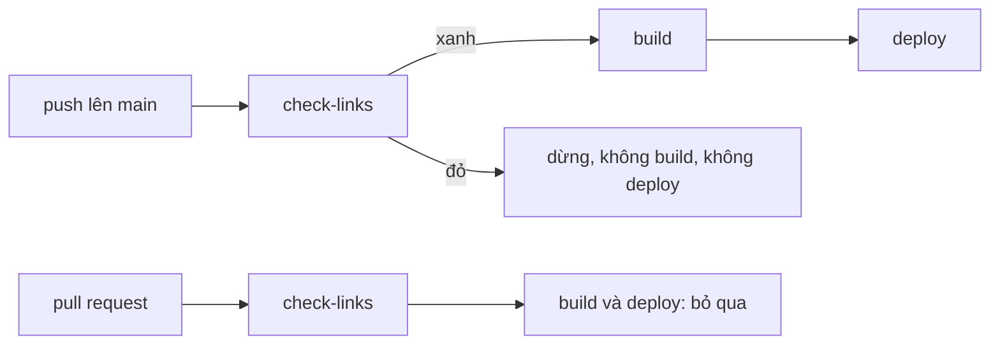

# Chặn link hỏng trước khi deploy

Đổi tên file `about.html` thành `gioi-thieu.html` mà quên sửa link trong `index.html` là người xem gặp trang 404. Đây chính là việc **CI** (Continuous Integration) làm tốt: kiểm tra tự động mỗi lần thay đổi, chặn lỗi trước khi nó lên site.

## Công cụ: lychee

[lychee](https://github.com/lycheeverse/lychee) đọc file HTML, tìm mọi link và kiểm tra từng link. Với tuỳ chọn `--offline`, nó chỉ kiểm tra link **trong repo** (file, ảnh, CSS), bỏ qua link ra ngoài. Nhờ vậy kết quả ổn định: không đỏ chỉ vì một trang bên ngoài tạm thời chậm.

## Workflow hoàn chỉnh

Sửa `.github/workflows/pages.yml` thành:

```yaml
name: Deploy Pages

on:
  push:
    branches: [main]
  pull_request:
  workflow_dispatch:

# Quyền tối thiểu cho mọi job. Job nào cần thêm thì tự xin.
permissions:
  contents: read

jobs:
  check-links:
    runs-on: ubuntu-latest
    steps:
      - uses: actions/checkout@v7

      - name: Kiểm tra link hỏng
        uses: lycheeverse/lychee-action@v2.9.0
        with:
          args: --offline --no-progress '**/*.html'
          fail: true

  build:
    needs: check-links
    # Chỉ đóng gói và deploy khi push lên main hoặc bấm Run workflow, không làm từ pull request
    if: github.event_name != 'pull_request'
    runs-on: ubuntu-latest
    steps:
      - uses: actions/checkout@v7

      - uses: actions/configure-pages@v6

      - name: Đóng gói trang web
        uses: actions/upload-pages-artifact@v5
        with:
          path: .

  deploy:
    needs: build
    runs-on: ubuntu-latest
    permissions:
      pages: write
      id-token: write
    # Không cho hai lần deploy chạy chồng lên nhau
    concurrency:
      group: pages
      cancel-in-progress: false
    environment:
      name: github-pages
      url: ${{ steps.deployment.outputs.page_url }}
    steps:
      - name: Deploy lên GitHub Pages
        id: deployment
        uses: actions/deploy-pages@v5
```

Những gì mới:

- **`needs: check-links`**: job `build` chờ `check-links` xong và **chỉ chạy khi nó xanh**. Job `deploy` vẫn `needs: build` như bài trước, nên cả chuỗi là `check-links` → `build` → `deploy`. Không có `needs` thì các job chạy song song, link hỏng vẫn được deploy.
- **`pull_request`** trong `on`: mở PR là có kiểm tra link, để bạn sửa trước khi merge.
- **`if: github.event_name != 'pull_request'`** đặt ở job `build`: trên PR chỉ kiểm tra, không đóng gói, không deploy. Job `deploy` không cần `if` riêng: job nó `needs` bị bỏ qua thì nó cũng bị bỏ qua. Job bị bỏ qua hiện màu xám.
- `'**/*.html'`: mọi file `.html` ở mọi thư mục. Giữ dấu nháy đơn để lychee tự tìm file.



## Thử làm hỏng

Tạo nhánh, sửa một link thành tên file không có, ví dụ `href="abuot.html"`, rồi mở pull request. Job `check-links` đỏ, log có dạng:

```text
### Errors in index.html

* [ERROR] <file:///home/runner/work/portfolio/portfolio/abuot.html> (at 12:12) | File not found. Check if file exists and path is correct
```

Log cho biết file nào (`index.html`) chứa link hỏng nào, ở dòng và cột nào (`12:12`). Sửa lại, push lên nhánh: PR tự chạy lại và xanh.

## Kiểm tra cả link ra ngoài?

Bỏ `--offline` thì lychee kiểm tra cả link tới LinkedIn, GitHub… Có ích nhưng hay đỏ vì lý do ngoài tầm tay (trang chặn bot, mạng chậm). Nếu muốn, thêm một workflow riêng chạy theo lịch mỗi tuần (xem chương 6 track Discord), đừng để nó chặn việc deploy.

## Tóm tắt

- CI kiểm tra tự động mỗi lần thay đổi; lychee `--offline` bắt link hỏng trong repo.
- `needs` nối job thành chuỗi `check-links` → `build` → `deploy`: chỉ deploy khi kiểm tra xanh.
- Trên pull request: kiểm tra, không build, không deploy.
