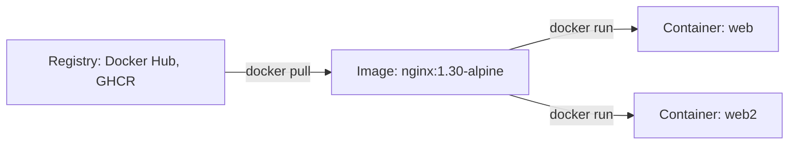

# Image và container

Portfolio của bạn đã lên GitHub Pages. Nhưng nhiều ứng dụng cần nhiều thứ hơn một trang tĩnh: một web server, một database, đúng phiên bản Node hay Python. Cài tay từng thứ trên máy mỗi người rất dễ sinh ra câu quen thuộc: "Máy mình chạy được mà!".

**Docker** đóng gói ứng dụng **cùng mọi thứ nó cần** thành một khối chạy giống nhau ở mọi nơi: máy bạn, máy mentor, runner của GitHub Actions hay máy chủ.

## Ba khái niệm

| Khái niệm | Là gì | So sánh |
| --- | --- | --- |
| **Image** | Bản đóng gói chỉ đọc: hệ điều hành tối giản, phần mềm, file của bạn, lệnh khởi động | Giống file cài đặt, hay "khuôn bánh" |
| **Container** | Một bản đang chạy của image, có file và tiến trình riêng | Giống chương trình đang chạy, hay "cái bánh" làm từ khuôn |
| **Registry** | Kho chứa image để tải về và chia sẻ | Docker Hub, GitHub Container Registry (GHCR) |

Từ **một** image có thể chạy **nhiều** container. Xóa container không làm mất image.



## Tên image

```text
nginx:1.30-alpine
ghcr.io/an/portfolio:main
```

- Phần trước dấu `:` là **tên** (có thể kèm địa chỉ registry, như `ghcr.io/an/`). Không ghi registry thì mặc định là Docker Hub.
- Phần sau dấu `:` là **tag**, thường là phiên bản. Không ghi tag thì Docker dùng `latest`.
- Luôn ghi tag cụ thể như `1.30-alpine`. `latest` có thể đổi bất cứ lúc nào, hôm nay chạy được, mai thì không.

## Container khác máy ảo thế nào?

Máy ảo giả lập cả một máy tính với hệ điều hành riêng, nặng vài GB, khởi động mất cả phút. Container dùng chung nhân (kernel) Linux của máy chủ, chỉ tách riêng file và tiến trình, nên nhẹ và khởi động trong vài giây.

Windows và macOS không có nhân Linux, nên **Docker Desktop** chạy một máy ảo Linux nhỏ ở bên dưới (trên Windows là WSL2). Bạn không cần quản lý máy ảo đó.

## Cài đặt

Làm theo tab **Cài đặt** của track: cài Docker Desktop, bật WSL2 trên Windows, rồi chạy:

```bash
docker run hello-world
```

Thấy dòng `Hello from Docker!` là xong. Lệnh này vừa làm đủ cả vòng: tìm image `hello-world` trên máy, không có thì **pull** từ Docker Hub, tạo container, chạy, in lời chào, rồi container dừng.

Máy yếu hoặc không cài được? Tab **Cài đặt** có cách dùng GitHub Codespaces hoặc Play with Docker trên trình duyệt.

## Tóm tắt

- Image là bản đóng gói chỉ đọc; container là image đang chạy; registry là kho image.
- Tên image dạng `tên:tag`. Luôn ghi tag cụ thể.
- `docker run hello-world` kiểm tra Docker đã cài đúng.
