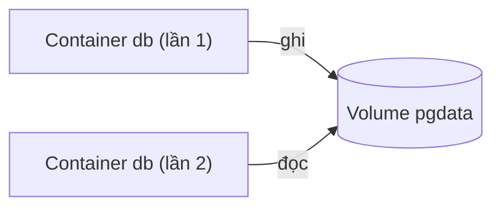

# Named volume: dữ liệu sống sót khi xóa container

Portfolio là trang tĩnh, xóa container rồi chạy lại vẫn y nguyên vì mọi thứ nằm trong image. Database thì khác: dữ liệu sinh ra **trong lúc chạy**. Chương 6 dùng Postgres để lưu số liệu truy cập của Umami; mất dữ liệu mỗi lần tạo lại container là không được.

## Thử: không có volume

```bash
docker run -d --name db -e POSTGRES_PASSWORD=matkhau postgres:18-alpine
```

`-e POSTGRES_PASSWORD=...` là bắt buộc với image `postgres`: thiếu thì container dừng ngay, `docker logs db` báo `Database is uninitialized and superuser password is not specified`. Chờ vài giây cho Postgres khởi động, rồi tạo bảng:

```bash
docker exec db psql -U postgres -c "CREATE TABLE notes (id serial PRIMARY KEY, body text); INSERT INTO notes (body) VALUES ('Xin chào Docker');"
```

Xóa container, chạy lại, tìm bảng:

```bash
docker rm -f db
docker run -d --name db -e POSTGRES_PASSWORD=matkhau postgres:18-alpine
docker exec db psql -U postgres -c "SELECT * FROM notes;"
```

```text
ERROR:  relation "notes" does not exist
```

Mất. Dữ liệu nằm trong lớp ghi của container, xóa container là xóa theo. Vừa chạy lại mà gặp `the database system is starting up` thì chờ vài giây rồi thử lại.

## Named volume

**Volume** là vùng lưu trữ do Docker quản lý, nằm **ngoài** container. Gắn nó vào thư mục dữ liệu của Postgres thì container đến rồi đi, dữ liệu vẫn ở lại.



```bash
docker rm -f db
docker volume create pgdata
docker run -d --name db -e POSTGRES_PASSWORD=matkhau -v pgdata:/var/lib/postgresql postgres:18-alpine
```

`-v pgdata:/var/lib/postgresql` nghĩa là gắn volume `pgdata` vào thư mục `/var/lib/postgresql` trong container. Từ bản 18, image `postgres` lưu dữ liệu dưới thư mục này. Bản 17 trở về trước thì gắn vào `/var/lib/postgresql/data`; xem trang image trên Docker Hub khi dùng bản khác.

Làm lại thí nghiệm:

```bash
docker exec db psql -U postgres -c "CREATE TABLE notes (id serial PRIMARY KEY, body text); INSERT INTO notes (body) VALUES ('Xin chào Docker');"
docker rm -f db
docker run -d --name db -e POSTGRES_PASSWORD=matkhau -v pgdata:/var/lib/postgresql postgres:18-alpine
docker exec db psql -U postgres -c "SELECT * FROM notes;"
```

```text
 id |      body
----+-----------------
  1 | Xin chào Docker
(1 row)
```

Còn nguyên.

## Quản lý volume

```bash
docker volume ls            # liệt kê
docker volume inspect pgdata
docker volume rm pgdata     # xóa (container dùng nó phải xóa trước)
```

`docker volume rm` xóa **vĩnh viễn** dữ liệu. Với database thật, sao lưu trước (ví dụ `pg_dump`).

Mật khẩu chỉ được đặt **lần đầu** Postgres khởi tạo volume. Đổi `POSTGRES_PASSWORD` sau đó không đổi mật khẩu trong volume cũ; đây là lỗi hay gặp ở chương 6.

## Bind mount: khi nào dùng?

`-v` còn nhận một **đường dẫn trên máy bạn**, gọi là bind mount, ví dụ `-v ./site:/usr/share/nginx/html`. Tiện khi đang phát triển: sửa file trên máy là container thấy ngay. Track này dùng named volume cho database vì Docker tự quản lý nó, không phụ thuộc đường dẫn và quyền file trên Windows hay macOS.

## Tóm tắt

- Dữ liệu ghi trong container mất khi xóa container.
- `-v tên-volume:/thư-mục` giữ dữ liệu ngoài container; Postgres 18 dùng `/var/lib/postgresql`.
- Mật khẩu Postgres chỉ được đặt lần đầu tạo volume.

Chưa dọn vội: bài sau dùng tiếp container `db`.
