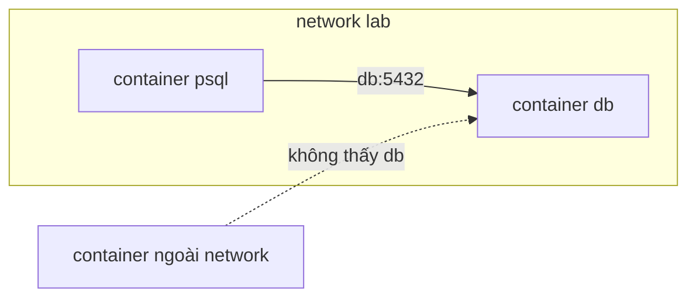

# Network: container gọi nhau bằng tên

Chương 6, Umami (một container) cần nói chuyện với Postgres (container khác). Nó tìm Postgres bằng cách nào?

## Network riêng

Trên một **network** do bạn tạo, Docker có DNS nội bộ: mỗi container được gọi bằng **tên** của nó.

```bash
docker rm -f db
docker network create lab
docker run -d --name db --network lab -e POSTGRES_PASSWORD=matkhau -v pgdata:/var/lib/postgresql postgres:18-alpine
```

Chạy một container khác trên cùng network, dùng `psql` kết nối tới máy tên `db`:

```bash
docker run --rm --network lab -e PGPASSWORD=matkhau postgres:18-alpine psql -h db -U postgres -c "SELECT count(*) FROM notes;"
```

```text
 count
-------
     1
(1 row)
```

`-h db`: tên container chính là tên máy. Bảng `notes` từ bài trước vẫn còn nhờ volume.

Thử từ một container **không** ở network `lab`:

```bash
docker run --rm postgres:18-alpine sh -c 'getent hosts db || echo "khong tim thay db"'
```

```text
khong tim thay db
```

Container chỉ thấy nhau khi cùng network.



## -p chỉ dành cho máy bạn

Để ý: container `db` **không có** `-p`, vậy mà container `psql` vẫn kết nối được tới cổng 5432. Giữa các container cùng network, mọi cổng đều thông. `-p` chỉ cần khi **máy bạn** (trình duyệt, công cụ trên máy) muốn truy cập vào container.

| Ai gọi | Gọi tới đâu | Cần `-p`? |
| --- | --- | --- |
| Trình duyệt trên máy bạn | `localhost:8080` | Có: `-p 8080:80` |
| Container khác cùng network | `db:5432` | Không |

Không mở cổng database ra ngoài khi không cần là một thói quen an toàn: càng ít cổng mở, càng ít chỗ bị tấn công.

Bên trong container, `localhost` là **chính container đó**, không phải máy bạn hay container khác. Umami mà kết nối `localhost:5432` sẽ báo lỗi, vì Postgres nằm ở container `db`.

## Dọn dẹp

```bash
docker rm -f db
docker network rm lab
docker volume rm pgdata
```

## Sắp tới: Compose làm hết việc này

Gõ tay `network create`, `volume create`, nhiều `-e`, đúng thứ tự… rất dễ sai. Chương 6 viết tất cả vào **một file** `compose.yaml`; Docker Compose tự tạo network chung cho mọi service, và tên service chính là tên máy.

## Tóm tắt

- Container cùng network gọi nhau bằng tên container.
- Giữa các container, cổng thông sẵn; `-p` chỉ để máy bạn truy cập.
- Trong container, `localhost` là chính nó.
