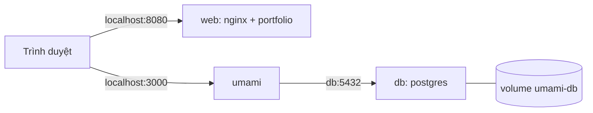

# Portfolio + Umami + Postgres

[Umami](https://umami.is) là công cụ thống kê truy cập web mã nguồn mở, gọn nhẹ, không dùng cookie theo dõi người xem. Nó chạy bằng image có sẵn và lưu dữ liệu vào Postgres. Bạn không phải viết dòng code backend nào, mà vẫn có một hệ thống ba container thật sự:



## 1. Mật khẩu vào .env

Tạo file `.env` cạnh `compose.yaml`:

```text
POSTGRES_PASSWORD=doi-mat-khau-nay
APP_SECRET=chuoi-ngau-nhien-dai
```

- `POSTGRES_PASSWORD`: mật khẩu database, dùng cho cả Postgres và Umami.
- `APP_SECRET`: chuỗi bí mật Umami dùng để ký phiên đăng nhập. Tạo một chuỗi ngẫu nhiên, ví dụ bằng `openssl rand -hex 32`.

**Không commit `.env`.** Thêm vào `.gitignore`:

```text
.env
```

Rồi tạo `.env.example` có **tên biến, không có giá trị thật**, và commit file này để người khác biết cần điền gì:

```text
# Copy file này thành .env rồi điền giá trị của bạn. KHÔNG commit .env.
POSTGRES_PASSWORD=doi-mat-khau-nay
APP_SECRET=chuoi-ngau-nhien-dai
```

Trước khi commit, kiểm tra bằng `git status`: không được thấy `.env` trong danh sách. Lỡ commit mật khẩu thật thì đổi mật khẩu đó; xem thêm chương 5 track [Tự động hoá với Discord](https://learn.hcmute-dsc.io.vn/tracks/discord-webhook-automation).

## 2. compose.yaml

```yaml
services:
  web:
    build: .
    ports:
      - "8080:80"
    healthcheck:
      test: ["CMD-SHELL", "wget -qO /dev/null http://localhost/ || exit 1"]
      interval: 5s
      timeout: 3s
      retries: 5

  umami:
    image: ghcr.io/umami-software/umami:3.5.0
    ports:
      - "3000:3000"
    env_file: .env
    environment:
      DATABASE_URL: postgresql://umami:${POSTGRES_PASSWORD}@db:5432/umami
    depends_on:
      db:
        condition: service_healthy
    healthcheck:
      test: ["CMD-SHELL", "curl -fs http://localhost:3000/api/heartbeat || exit 1"]
      interval: 5s
      timeout: 5s
      retries: 20
      start_period: 20s

  db:
    image: postgres:18-alpine
    environment:
      POSTGRES_DB: umami
      POSTGRES_USER: umami
      POSTGRES_PASSWORD: ${POSTGRES_PASSWORD}
    volumes:
      - umami-db:/var/lib/postgresql
    healthcheck:
      test: ["CMD-SHELL", "pg_isready -U umami -d umami"]
      interval: 5s
      timeout: 5s
      retries: 10

volumes:
  umami-db:
```

## 3. Đọc hiểu

**Biến môi trường, hai cách:**

| Cách | Làm gì |
| --- | --- |
| `${POSTGRES_PASSWORD}` trong file | Compose tự đọc `.env` cạnh `compose.yaml` và **thay chữ** trước khi chạy. Dùng khi cần ghép giá trị vào chuỗi, như `DATABASE_URL`. |
| `env_file: .env` | Đưa **mọi biến** trong `.env` vào bên trong container, giống nhiều `-e`. Umami đọc `APP_SECRET` theo cách này. |
| `environment:` | Đặt biến trực tiếp, giống `-e KEY=value`. |

**`DATABASE_URL`** có dạng `postgresql://<user>:<mật khẩu>@<máy>:<cổng>/<database>`. Máy là `db`: tên service, như chương 5.

**`db` không có `ports`.** Chỉ Umami cần nói chuyện với Postgres, qua network nội bộ. Không mở cổng database ra máy.

**Volume:** `volumes:` ở cuối file khai báo named volume `umami-db`; service `db` gắn nó vào `/var/lib/postgresql`. Compose tự tạo volume, tên thật là `<thư-mục>_umami-db`.

**Healthcheck và depends_on:**

- `healthcheck` là lệnh Docker chạy định kỳ trong container để hỏi "bạn ổn chưa?". Lệnh trả về 0 là **healthy**. `pg_isready` hỏi Postgres đã nhận kết nối chưa; Umami có sẵn đường dẫn `/api/heartbeat`.
- `depends_on` với `condition: service_healthy`: Umami chỉ được khởi động khi `db` đã **healthy**. Chỉ ghi `depends_on: [db]` thì Compose chỉ chờ container `db` **bắt đầu chạy**, lúc Postgres chưa sẵn sàng, và Umami có thể dừng vì lỗi kết nối (bài sau thử).
- `start_period: 20s`: trong 20 giây đầu, lần kiểm tra thất bại chưa tính, vì Umami cần thời gian chuẩn bị database lần đầu.

## 4. Chạy

```bash
docker compose up -d --wait
```

`--wait` chờ tới khi mọi service **healthy** rồi mới trả lại terminal. Lần đầu mất một lúc để tải image.

```bash
docker compose ps
```

Output (đã bỏ bớt vài cột):

```text
NAME                IMAGE                                SERVICE   STATUS                    PORTS
portfolio-db-1      postgres:18-alpine                   db        Up 22 seconds (healthy)   5432/tcp
portfolio-umami-1   ghcr.io/umami-software/umami:3.5.0   umami     Up 16 seconds (healthy)   0.0.0.0:3000->3000/tcp
portfolio-web-1     portfolio-web                        web       Up 22 seconds (healthy)   0.0.0.0:8080->80/tcp
```

## 5. Gắn Umami vào portfolio

1. Mở <http://localhost:3000>, đăng nhập tài khoản mặc định `admin` / `umami`. **Đổi mật khẩu ngay** trong phần cài đặt tài khoản.
2. Thêm website mới: tên `Portfolio`, domain `localhost`.
3. Mở phần mã theo dõi (tracking code) của website vừa tạo. Umami cho một dòng có dạng như bên dưới.
4. Dán dòng đó vào `<head>` của `index.html`, rồi build lại web bằng lệnh bên dưới.
5. Mở <http://localhost:8080> vài lần, rồi xem trang thống kê của website trong Umami: số lượt xem tăng lên.

Mã theo dõi (bước 3):

```html
<script defer src="http://localhost:3000/script.js" data-website-id="<id-website-của-bạn>"></script>
```

Build lại web (bước 4):

```bash
docker compose up -d --build --wait
```

Mã theo dõi trỏ tới `localhost:3000`, nên chỉ đếm được khi bạn xem trên chính máy mình. Đưa Umami lên một máy chủ thật nằm ngoài phạm vi track này; dự án cuối chỉ cần chạy được trên máy.

## 6. Dừng và dữ liệu

```bash
docker compose down        # xóa container và network; volume umami-db VẪN CÒN
docker compose up -d --wait   # chạy lại: website và lượt xem vẫn còn
docker compose down -v     # xóa luôn volume: mất hết dữ liệu Umami
```

## Tóm tắt

- `.env` giữ mật khẩu, nằm trong `.gitignore`; `.env.example` được commit.
- `${VAR}` thay chữ trong `compose.yaml`; `env_file` đưa biến vào container.
- `healthcheck` + `depends_on: condition: service_healthy` để chờ database thật sự sẵn sàng; `up -d --wait` chờ mọi service healthy.
- `down` giữ volume, `down -v` xóa volume.
