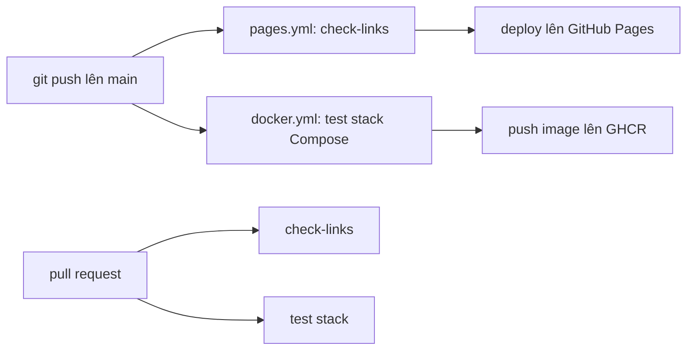

# Hướng dẫn dự án cuối

Bạn đã có đủ mảnh ghép. Dự án cuối ráp chúng lại thành **một repo portfolio** mà người khác mở ra là hiểu, clone về là chạy được, và mỗi lần push thì máy tự kiểm tra.

## Repo hoàn chỉnh trông thế nào

```text
portfolio/
├── .github/
│   ├── workflows/
│   │   ├── pages.yml        # chương 2: kiểm tra link, deploy Pages
│   │   └── docker.yml       # chương 7: test stack, push image lên GHCR
│   └── dependabot.yml       # tuỳ chọn, chương 7
├── index.html, style.css, images/ …
├── Dockerfile               # chương 4
├── .dockerignore
├── compose.yaml             # chương 6: web + umami + db
├── .env.example             # commit; .env thì KHÔNG
├── .gitignore               # có dòng .env
└── README.md
```



## README

README là trang đầu tiên người khác (và mentor) đọc. Cần có:

1. **Tên và một câu mô tả**, link tới trang GitHub Pages.
2. **Badge** trạng thái của hai workflow.
3. **Chạy trên máy** bằng Compose: các bước từ `git clone` tới mở `localhost:8080` và `localhost:3000`, kể cả bước tạo `.env`.
4. **Chạy image từ GHCR**: lệnh `docker pull` và `docker run`.
5. **Pipeline**: mỗi workflow chạy khi nào, làm gì (vài dòng hoặc sơ đồ).

### Badge

Mỗi workflow có sẵn một ảnh badge xanh/đỏ theo lần chạy gần nhất. Đổi `an/portfolio` thành repo của bạn:

```markdown
[](https://github.com/an/portfolio/actions/workflows/pages.yml)
[](https://github.com/an/portfolio/actions/workflows/docker.yml)
```

Cũng lấy được từ tab **Actions** → chọn workflow → nút **…** → **Create status badge**.

### Mẫu phần "Chạy trên máy"

````markdown
## Chạy trên máy

Cần Docker Desktop (hoặc Docker Engine có Compose).

```bash
git clone https://github.com/an/portfolio.git
cd portfolio
cp .env.example .env      # rồi đổi mật khẩu trong .env
docker compose up -d --wait
```

- Portfolio: http://localhost:8080
- Umami: http://localhost:3000 (lần đầu đăng nhập admin / umami, đổi mật khẩu ngay)

Dừng: `docker compose down`. Xóa cả dữ liệu Umami: `docker compose down -v`.
````

## Tự kiểm tra trước khi nộp

Làm trên một thư mục **mới clone**, không phải thư mục bạn đang làm việc, để chắc chắn không phụ thuộc file chỉ có trên máy bạn:

```bash
git clone https://github.com/<bạn>/<repo>.git kiem-tra
cd kiem-tra
cp .env.example .env
docker compose up -d --wait
docker compose ps
docker compose down -v
```

Rồi đi qua danh sách:

- [ ] Hai badge đều xanh.
- [ ] Trang GitHub Pages mở được, đủ CSS và ảnh.
- [ ] Mở một pull request thử: `check-links` và `test` chạy; `deploy` và `push-image` bị bỏ qua.
- [ ] Package GHCR public, `docker pull` về chạy được khi chưa đăng nhập.
- [ ] `git log --all --oneline -- .env` không in gì (chưa từng commit `.env`).
- [ ] Đã chạy actionlint trên máy, không báo lỗi.
- [ ] Đi qua "Danh sách tự kiểm tra" ở bài "Workflow an toàn".

## Nộp bài và review

Nộp link repo ở bài tập bên dưới. Mentor sẽ clone, chạy theo README, xem các lần chạy workflow và chấm theo rubric. Nhận xét có ít nhất một điểm bạn làm tốt và một điểm nên sửa; sửa xong thì nộp lại.

## Làm thêm nếu còn sức

- Kiểm tra cả link ra ngoài bằng một workflow chạy theo lịch mỗi tuần (bỏ `--offline`, xem chương 6 track Discord về `schedule`).
- Bật Dependabot và merge một PR nó mở.
- Gắn healthcheck cho image ngay trong `Dockerfile` bằng lệnh `HEALTHCHECK`.
- Tự làm một release: `git tag v1.0.0`, push tag, thấy image tag `1.0.0` trên GHCR.
